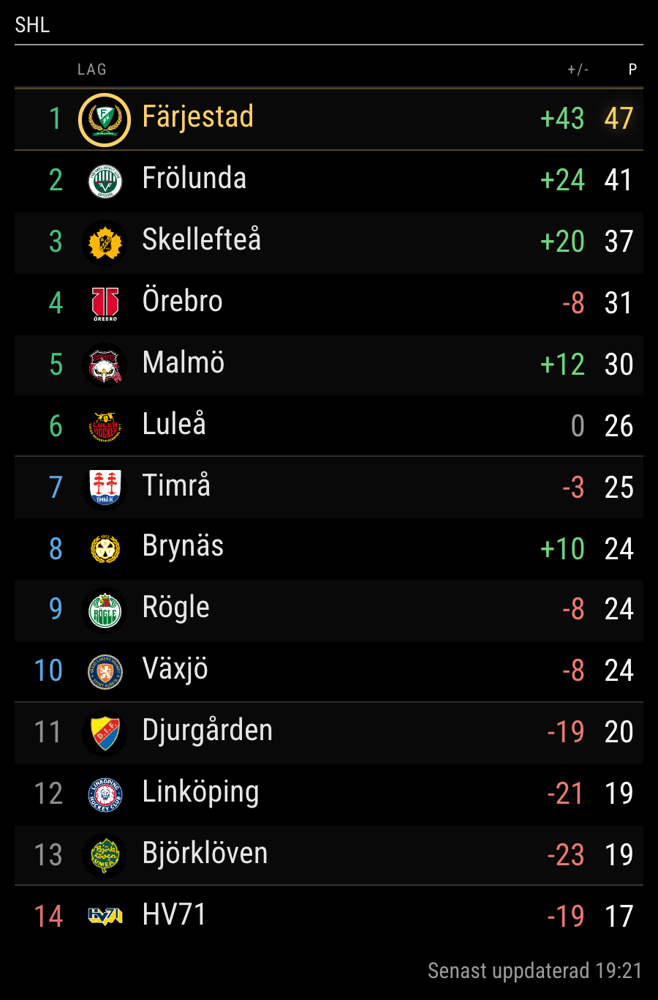
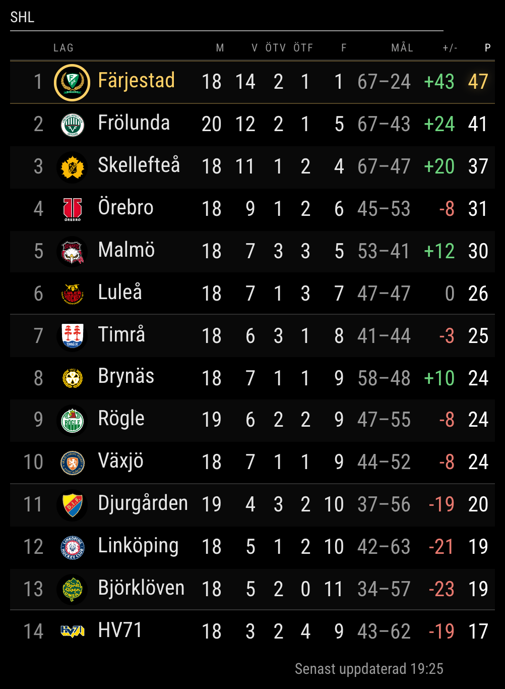
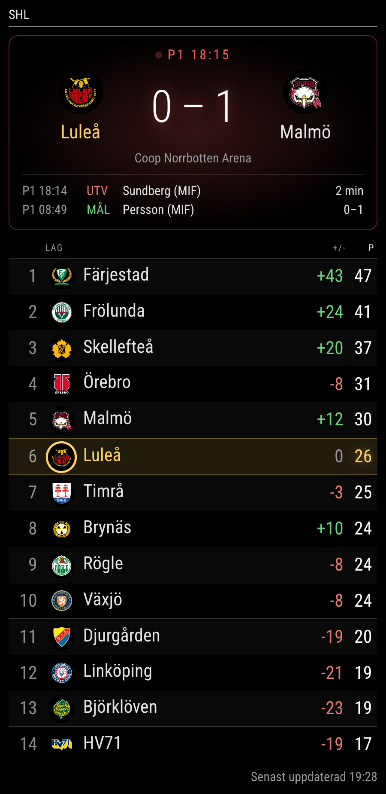
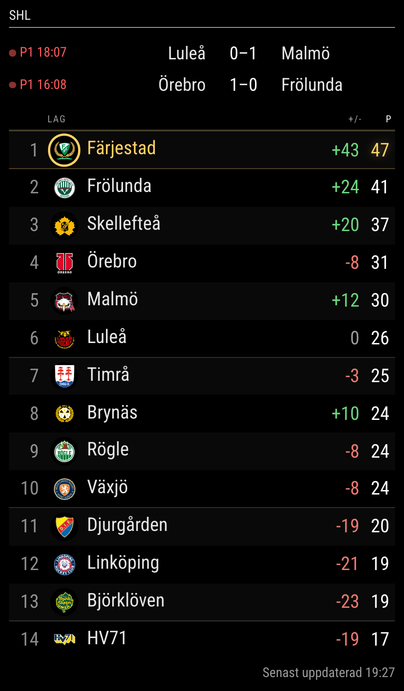
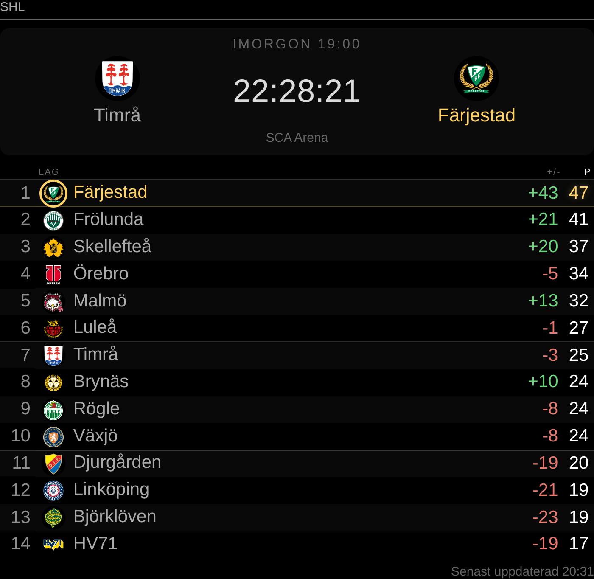

# MMM-SHL-Tabell

A [MagicMirror²](https://magicmirror.builders) module showing the **SHL standings table** (Svenska hockeyligan), with live scores while games are being played and an optional highlighted favourite team.

Built for a portrait 1080×1920 mirror. Everything on screen is Swedish; the code is English.

```
                   ● LIVE  P2 12:34
            🛡 Färjestad  2 – 1  Luleå 🛡
                  Coop Norrbotten Arena

      LAG           M   V  ÖTV ÖTF  F    MÅL   +/-   P
 ▌ 1  🛡 Färjestad  18  14   2   1   1   67–24  +43  47   ← favourite, lit
 ▌ 2  🛡 Frölunda   20  12   2   1   5   67–43  +24  41
 ▌ 3  🛡 Skellefteå 18  11   1   2   4   67–47  +20  37   green = playoffs
 ▌ …
 ▌ 7  🛡 Timrå      18   6   3   1   8   41–44   -3  25   blue = play-in
 ▌ …
   11 🛡 Djurgården 19   4   3   2  10   37–56  -19  20   mid-table, no colour
   …
 ▌14  🛡 HV71       18   3   2   4   9   43–62  -19  17   red = play-out
                                      Senast uppdaterad 18:46
```

| Default | `showAllStats: true` |
|---|---|
|  |  |

## What it does

- **The standings table** — all 14 teams with their crests, goal difference and points (or every column the SHL table conventionally shows, with `showAllStats`), and rules marking the playoff, play-in and play-out lines.
- **Colour that means something** — green/red on goal difference, and nothing decorative. Rank numbers can optionally be coloured by qualification zone. Crests carry the club colour so the table doesn't have to.
- **Live scores** — when a game is in progress, the score, period and clock appear above the table.
- **A reminder the day before** — from 24 hours before puck drop the game appears above the table, with a countdown ticking where the score will be. Once the game is over the panel goes away, so the rest of the time the table sits alone.
- **A favourite team** — highlighted in the table, and their game surfaced prominently when they play.
- **Graceful failure** — the last good table is cached to disk and rendered with a "senast uppdaterad" stamp if the feed goes away. A wall display should never go blank or show a stack trace.

## Installation

```bash
cd ~/MagicMirror/modules
git clone https://github.com/htilly/MMM-SHL-Tabell.git
```

No `npm install` — the module has **no dependencies**. It uses native `fetch`, so it needs **Node 18 or newer** (MagicMirror 2.30+ already requires that).

## Configuration

Minimal:

```js
{
    module: "MMM-SHL-Tabell",
    position: "lower_third",
    config: {
        favoriteTeam: "FBK"
    }
}
```

With the options worth knowing about:

```js
{
    module: "MMM-SHL-Tabell",
    classes: "main",
    position: "lower_third",
    config: {
        header: "SHL",
        favoriteTeam: "FBK",      // code or short name; "" for none
        liveGames: "favorite",    // "favorite" | "all" | "off"
        maxRows: 14,
        dividers: [6, 10, 13],
        showAllStats: true,       // default false = only +/- and points
        showLogos: false,
        showUpdated: true
    }
}
```

### Options

| Option | Default | Description |
|---|---|---|
| `header` | `"SHL"` | Module header. Set to `""` to hide it. |
| `favoriteTeam` | `"FBK"` | Which team to highlight. See [team codes](#team-codes) below. Case-insensitive; accepts the code or the short name. `""` for no favourite. |
| `liveGames` | `"favorite"` | Which games appear above the table. See [live games](#live-games). |
| `reminderLead` | `86400000` | How long before puck drop (ms) a game appears with its countdown. 24 hours by default. |
| `showEvents` | `true` | List the three latest goals and penalties in the favourite's live panel. Only with `liveGames: "favorite"`, and only while the game is on. |
| `maxRows` | `14` | How many teams to show. `14` is the whole league; lower it for a top slice. |
| `dividers` | `[6, 10, 13]` | Draw a rule *after* these ranks. The SHL default marks direct playoff places (1–6), play-in (7–10) and the play-out spot (14). |
| `zones` | `null` | Uncoloured rank numbers by default. Set to e.g. `{ playoff: 6, playin: 10, relegation: 14 }` to colour them by qualification zone: green to `playoff`, blue to `playin`, red from `relegation` down. |
| `showAllStats` | `false` | `false` shows only `+/-` and `P` (points). `true` shows every column. |
| `showLogos` | `true` | Show team crests. Each is downloaded once into `cache/logos/` and served locally thereafter, so this costs 14 fetches in total, not 14 per render. |
| `showUpdated` | `true` | Show the "senast uppdaterad" line under the table. |
| `staleWarningMinutes` | `90` | How long without fresh data before the stamp turns into a visible warning. Based on age alone, so a helper that dies silently is still caught. |
| `resubscribeAfter` | `5400000` | Re-subscribe if the node helper has said nothing for this long (90 min). Guards against a server restart leaving the front end orphaned. |
| `liveInterval` | `60000` | Poll interval (ms) while a game is being played. |
| `gamedayInterval` | `600000` | Poll interval on a day with games, outside play. |
| `idleInterval` | `1800000` | Poll interval when there is no hockey. |
| `preGameLead` | `1200000` | How long before puck drop to switch to the fast interval. |
| `seriesUuid` | `"qQ9-bb0bzEWUk"` | SHL's series UUID. Only change this to point the module at another Sportality-run league. |
| `timeZone` | `"Europe/Stockholm"` | Used for displayed times. |

### Team codes

For the **2026/27 season**:

| Code | Team | Also accepted |
|---|---|---|
| `FBK` | Färjestad BK | `Färjestad` |
| `FHC` | Frölunda HC | `Frölunda` |
| `SAIK` | Skellefteå AIK | `SKE`, `Skellefteå` |
| `OHK` | Örebro Hockey | `ÖRE`, `Örebro` |
| `MIF` | Malmö Redhawks | `Malmö` |
| `LHF` | Luleå Hockey | `Luleå` |
| `TIK` | Timrå IK | `Timrå` |
| `BIF` | Brynäs IF | `Brynäs` |
| `RBK` | Rögle BK | `Rögle` |
| `VLH` | Växjö Lakers | `Växjö` |
| `DIF` | Djurgårdens IF | `Djurgården` |
| `LHC` | Linköping HC | `Linköping` |
| `IFB` | Björklöven | — |
| `HV71` | HV71 | — |

Matching is case- and whitespace-insensitive, so `FBK`, `fbk` and ` Färjestad ` are all the same thing. The long name (`Färjestad BK`) works too.

Two teams carry two different codes in the SHL API — Skellefteå is `SAIK` in the standings but `SKE` in the game feeds, and Örebro is `OHK` and `ÖRE` — so **both are accepted** for each.

If `favoriteTeam` doesn't match any team, the module logs a warning naming the valid codes and renders a plain table with no highlight. It does not error.

If `favoriteTeam` is `""`, there is simply no favourite: no highlight, and with `liveGames: "favorite"` no live panel either.

### Live games

| Value | Behaviour |
|---|---|
| `"favorite"` *(default)* | Show only the favourite team's game: from 24 hours before puck drop the fixture with a countdown, then the live score and clock during play. Gone as soon as the game is over. Nothing otherwise. The quiet choice for a wall display. |
| `"all"` | Show every game in progress; otherwise the fixtures starting within the next 24 hours. |
| `"off"` | Standings only. |

With `liveGames: "favorite"` and no `favoriteTeam` set, nothing is shown — it does not silently fall back to `"all"`.

| `liveGames: "favorite"` (with `favoriteTeam: "LHF"`) | `liveGames: "all"` |
|---|---|
|  |  |

When there are no games at all, no panel is rendered: no empty box, no placeholder, just the table.

### Countdown



Before puck drop the score slot holds a countdown (`22:28:21`, or `1 d 02:00:00` with a longer `reminderLead`), and the line above says when: *Ikväll 19:00*, *Idag 15:15* or *Imorgon 19:00*. It ticks every second in the browser by rewriting its own text — no redraw, no extra fetches. At zero it reads *Nedsläpp* until the league lists the game as live.

The next game day is fetched alongside today's games (at most every 30 minutes), so the reminder shows up even when other teams are playing tonight.

A game whose start has passed but that never shows up as live is dropped after 30 minutes, so a feed that lags behind the final whistle cannot leave a stale fixture up all evening.

## Data source

shl.se's own site API — the feed their gameday widget uses.

| Purpose | Endpoint |
|---|---|
| Current season/series | `GET /api/sports-v2/latest-ssgt/{seriesUuid}` |
| Standings | `GET /api/statistics-v2/league-standings?ssgtUuid=…` |
| Today's games | `GET /api/sports-v2/today-games?seasonSeriesGameType=…` |
| Next game day | `GET /api/sports-v2/next-game-day?seasonSeriesGameType=…` |
| Games in progress | `GET /api/sports-v2/upcoming-live-games` |
| Live score and clock | `GET /api/gameday/game-overview/{gameUuid}` |
| Goals and penalties | `GET /api/gameday/play-by-play/{gameUuid}` |

All require the header `x-s8y-instance-id: shl1_shl`. No API key, no account.

> **This is an undocumented internal API.** It is not versioned, not published, and carries no stability guarantee — SHL can rename or change it without notice. That is a deliberate trade: the old documented `openapi.shl.se` was shut down (it returns a Cloudflare origin error today) and every alternative needs an account and a key. The module is built to survive the endpoint disappearing: every success is cached to disk, and a failure renders the last good table with a timestamp rather than an error.
>
> Please don't lower the poll intervals. The defaults are already generous to a service that owes us nothing.

### Season rollover

The `ssgtUuid` identifying the current season changes every year, so it is resolved at runtime via `latest-ssgt` and cached for 12 hours. Nothing needs editing in July.

During the off-season the standings endpoint may return an empty table; the module keeps showing the last cached one rather than rendering an empty grid.

## How polling works

The standings only move when a game ends, so there is no point refetching them on every live tick — they refresh at most every 5 minutes.

The game poll adapts:

| Situation | Interval |
|---|---|
| A game is in progress | 60s |
| Within 20 minutes of puck drop | 60s |
| Games today, but hours away | 10 min |
| No games today | 30 min |

Tomorrow's fixtures, fetched for the countdown, do not count as a game day: an idle day stays at 30 minutes.

`upcoming-live-games` — the call that decides whether anything is live — returns about 90 bytes, which is what makes the 60-second tick reasonable. The heavier `game-overview` call is made only for games the league itself lists as live.

## Tests

```bash
npm test
```

59 tests, no network and no DOM.

- `test/core.test.js` — the pure logic in `shl-core.js`: team matching, live-state detection, panel selection in each mode, zone mapping, poll scheduling, formatting.
- `test/helper.test.js` — the degraded paths that decide whether the wall shows a stale table or an empty one: serving from cache before any network call, surviving a failed fetch, the cold start with neither cache nor network, the season-lookup fallback, the staleness footnote, and the re-subscribe watchdog. MagicMirror's `node_helper` and `logger` modules are stubbed; everything under test is the real code.

## Development notes

- `shl-core.js` — pure functions, loaded by both the node helper and the browser. No I/O.
- `lib/api.js` — all network and disk access, including the logo cache.
- `node_helper.js` — scheduling; one shared poller regardless of instance count.
- `MMM-SHL-Tabell.js` — rendering only.

Three places where the API fights back, and what the code does about it:

- **The live `time` object** from `game-overview` is undocumented and empty before puck drop, so `readGameTime()` looks for any of several plausible key names and renders nothing when it finds none. A missing clock costs a line of detail; a thrown `TypeError` would cost the whole display.
- **`state` is not trustworthy for liveness.** `gameday` reports `"Ongoing"` roughly an hour before puck drop while `today-games` still says `"pre-game"`. A game counts as live only when the league's own live list names it, the start time has passed, and it hasn't finished.
- **Team codes are not consistent between endpoints.** Skellefteå is `SAIK` in the standings and `SKE` in the game feeds; Örebro is `OHK` and `ÖRE`. Both are accepted everywhere a team is matched.

## Licence

UNLICENSED — private.
